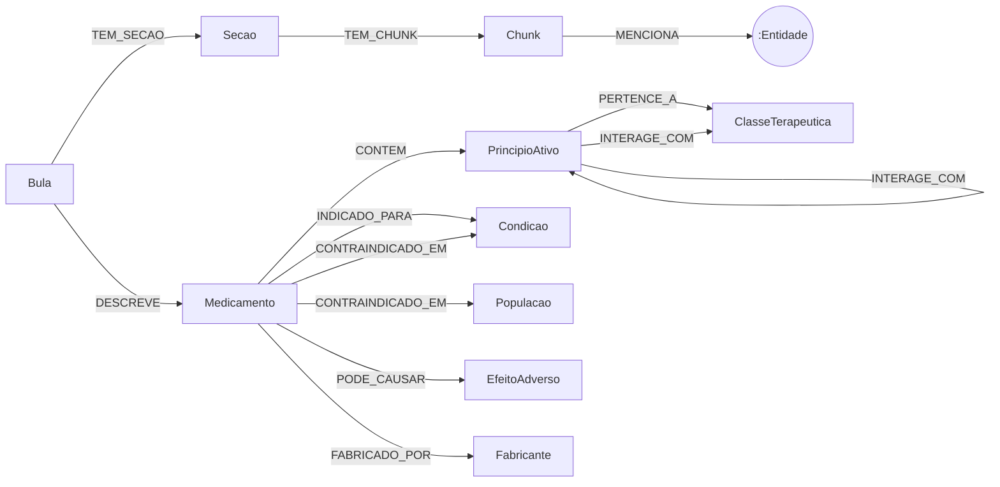

# Modelagem do grafo (E1)

Documento de referência do schema LPG no Neo4j. Cobre E1.1 (perguntas-alvo), E1.2 (modelo
conceitual) e E1.5 (justificativas para o artigo). Qualquer mudança no schema passa por aqui
primeiro e é avisada a P3, P4, P5 e P6.

## 1. Perguntas-alvo (E1.1)

O schema existe para responder a quatro tipos de pergunta. Cada tipo exige relações
específicas e pelo menos uma pergunta de cada tipo precisa de mais de um salto.

| Tipo | Exemplo | Caminho no grafo |
|---|---|---|
| Interação entre fármacos | "Posso tomar Marevan com Advil?" | `Medicamento-CONTEM->PrincipioAtivo-INTERAGE_COM-PrincipioAtivo<-CONTEM-Medicamento` |
| Interação por classe | "Varfarina interage com algum AINE?" | `PrincipioAtivo-INTERAGE_COM->ClasseTerapeutica<-PERTENCE_A-PrincipioAtivo` |
| Contraindicação por população | "Quais anti-hipertensivos são contraindicados na gravidez?" | `ClasseTerapeutica<-PERTENCE_A-PrincipioAtivo<-CONTEM-Medicamento-CONTRAINDICADO_EM->Populacao` |
| Efeitos adversos | "Que efeitos losartana e enalapril têm em comum?" | `Medicamento-PODE_CAUSAR->EfeitoAdverso<-PODE_CAUSAR-Medicamento` |
| Indicação | "Que remédios tratam hipertensão?" | `Medicamento-INDICADO_PARA->Condicao` |
| Equivalência | "Qual medicamento tem o mesmo princípio ativo do Cozaar?" | mesmo conjunto de `CONTEM` |
| Sem resposta | "Qual a dose de Cozaar para cães?" | ausência de caminho: o sistema deve recusar |

## 2. Diagrama

## 3. Nós

### Entidades de domínio

Todos os nós de domínio têm também o label `:Entidade` e estas propriedades:

| Propriedade | Tipo | Descrição |
|---|---|---|
| `id` | string | slug estável, minúsculo, sem acento (`losartana`, `cozaar`) |
| `nome` | string | forma de exibição (`Losartana`, `Cozaar`) |
| `sinonimos` | list<string> | outras grafias e nomes (`losartana potássica`) |
| `embedding_nome` | list<float> (1024) | embedding bge-m3 de `nome`, gravado por `embed_missing` |

| Label | Propriedades extras | Observação |
|---|---|---|
| `Medicamento` | `registro_anvisa`, `generico: bool` | nome comercial ou genérico |
| `PrincipioAtivo` | — | `id` = nome canônico da DCB, sem sal (`losartana`, não `losartana potássica`) |
| `ClasseTerapeutica` | — | ex.: `aine`, `anticoagulante`, `ieca`, `bra` |
| `Condicao` | — | doença, sintoma ou estado clínico (`hipertensao`, `insuficiencia_renal`) |
| `EfeitoAdverso` | — | ex.: `tosse_seca`, `hemorragia` |
| `Fabricante` | — | laboratório |
| `Populacao` | — | só 4 valores: `gestante`, `lactante`, `pediatrico`, `idoso` |

### Documento

| Label | Propriedades | Observação |
|---|---|---|
| `Bula` | `id`, `url`, `data_publicacao`, `tipo` (`profissional`) | `id` = `bula_<id do medicamento>` |
| `Secao` | `id`, `tipo` | `tipo` ∈ `indicacoes`, `contraindicacoes`, `advertencias`, `interacoes`, `reacoes_adversas`, `posologia` |
| `Chunk` | `id`, `texto`, `ordem`, `embedding` (1024) | `id` = `<id da secao>_<ordem>` |

## 4. Relações

| Relação | Propriedades |
|---|---|
| `(:Bula)-[:DESCREVE]->(:Medicamento)` | — |
| `(:Bula)-[:TEM_SECAO]->(:Secao)` | — |
| `(:Secao)-[:TEM_CHUNK]->(:Chunk)` | — |
| `(:Chunk)-[:MENCIONA]->(:Entidade)` | — |
| `(:Medicamento)-[:CONTEM]->(:PrincipioAtivo)` | `dose` (ex.: `50 mg`) |
| `(:PrincipioAtivo)-[:PERTENCE_A]->(:ClasseTerapeutica)` | — |
| `(:Medicamento)-[:INDICADO_PARA]->(:Condicao)` | — |
| `(:Medicamento)-[:CONTRAINDICADO_EM]->(:Condicao\|Populacao)` | — |
| `(:Medicamento)-[:PODE_CAUSAR]->(:EfeitoAdverso)` | `frequencia` |
| `(:PrincipioAtivo)-[:INTERAGE_COM]->(:PrincipioAtivo\|ClasseTerapeutica)` | `gravidade`, `efeito` |
| `(:Medicamento)-[:FABRICADO_POR]->(:Fabricante)` | — |

Vocabulários fechados:

- `frequencia`: `muito_comum`, `comum`, `incomum`, `rara`, `muito_rara`, `desconhecida` (escala
  das bulas da ANVISA).
- `gravidade`: `grave`, `moderada`, `leve`, `desconhecida`.

Proveniência: toda relação de domínio (tudo menos `DESCREVE`, `TEM_SECAO`, `TEM_CHUNK`,
`MENCIONA`) guarda `fonte_chunk_id`, `confianca` (0–1) e `metodo` (`manual` ou `llm`). No grafo
semente, `confianca = 1.0` e `metodo = 'manual'`.

## 5. Índices

| Nome | Tipo | Alvo |
|---|---|---|
| `<label>_id` | unicidade | `id` de cada label de domínio e de `Bula`, `Secao`, `Chunk` |
| `entidade_nomes` | fulltext | `:Entidade(nome, sinonimos)` |
| `chunk_texto` | fulltext | `Chunk(texto)` |
| `entidade_embedding` | vector, 1024, cosseno | `:Entidade(embedding_nome)` |
| `chunk_embedding` | vector, 1024, cosseno | `Chunk(embedding)` |
| `secao_tipo` | range | `Secao(tipo)` |

## 6. Justificativas

- **Label `:Entidade` comum.** No Neo4j 5, um índice vetorial cobre um label só. Com um label
  comum, um índice vetorial e um fulltext servem para a resolução de entidades (E4) e para achar
  as seeds do retrieval (E5), sem uma consulta por label.
- **Interação no princípio ativo, não no medicamento.** A interação é farmacológica. Gravada no
  princípio ativo, vale para todo medicamento que o contém (genéricos incluídos) e cria o
  multi-hop `Medicamento → PrincipioAtivo → PrincipioAtivo → Medicamento`.
- **Interação com classe.** Bulas costumam dizer "evitar o uso com AINEs" sem nomear fármacos.
  `INTERAGE_COM -> ClasseTerapeutica` guarda isso fiel ao texto; o retrieval desce para os
  princípios ativos da classe.
- **`INTERAGE_COM` gravada numa direção só.** Interação é simétrica. Gravar nos dois sentidos
  duplica dados e confiança. As consultas leem sem direção: `-[:INTERAGE_COM]-`.
- **Equivalência sem relação própria.** Dois medicamentos são equivalentes quando têm o mesmo
  conjunto de `CONTEM`. Uma relação `EQUIVALENTE_A` seria dado derivado que desatualiza.
- **`Populacao` separada de `Condicao`.** Gestante ou idoso não é doença. Separar permite a
  pergunta "contraindicado na gravidez" sem confundir com condições clínicas.
- **`DESCREVE`.** Liga a bula ao medicamento para que a proveniência vá da resposta até o
  documento de origem.
- **Proveniência nas relações.** `fonte_chunk_id` e `confianca` permitem citar o trecho da bula
  na resposta (E5.6) e filtrar extrações fracas.

## 7. Grafo semente (E1.4)

Cinco bulas escolhidas para se cruzarem:

| Medicamento | Princípio ativo | Classe |
|---|---|---|
| Cozaar | losartana | BRA (anti-hipertensivo) |
| Renitec | enalapril | IECA (anti-hipertensivo) |
| Marevan | varfarina | anticoagulante |
| Advil | ibuprofeno | AINE |
| Aspirina | ácido acetilsalicílico | AINE / antiagregante |

Cruzamentos garantidos: varfarina com AINEs (risco de sangramento), AINEs reduzindo o efeito de
anti-hipertensivos, IECA e BRA contraindicados na gravidez, efeitos adversos comuns a losartana
e enalapril.

Os fatos do semente foram escritos à mão a partir do conhecimento geral dessas bulas. P2 confere
contra o texto do Bulário Eletrônico da ANVISA antes de usá-los no gold set (E2.5, E7.1).

## 8. Arquivos e uso

| Arquivo | Conteúdo |
|---|---|
| `cypher/schema.cypher` | constraints e índices, todos com `IF NOT EXISTS` |
| `cypher/seed.cypher` | grafo semente, só `MERGE` (pode rodar de novo sem duplicar) |
| `src/graphrag_bulas/embeddings.py` | `embed_missing(driver)`: grava embeddings que faltam |
| `tests/test_seed.py` | uma consulta por pergunta-alvo; pulado sem Neo4j |

Comandos no README, seção "Banco de dados".
